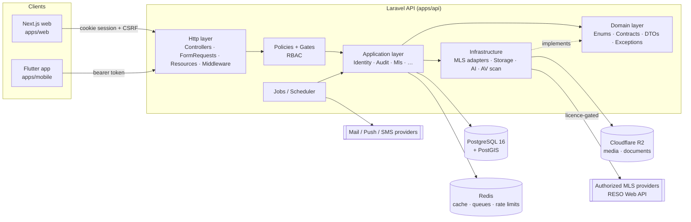

# Component Design

## 1. Component diagram

## 2. API modules (bounded contexts)

| Module | Status | Responsibilities | Key classes |
|---|---|---|---|
| Identity & Access | **Implemented** | Registration, cookie/token auth, MFA, password reset, e-mail verification, sessions, RBAC, user administration | `CredentialVerifier`, `MfaService`, `RegisterUser`, `UserAdministration`, `SessionManager`, `UserPolicy`, `RoleName`, `Permission` |
| Audit | **Implemented** | Append-only audit trail, secret redaction | `AuditLogger`, `AuditLog` |
| MLS Integration Engine | **Implemented** (contract + sync pipeline); production sync blocked by external authorization | Provider contract, RESO adapter, normalization, compliance rules, encrypted connections, import/incremental/reconcile jobs, dedup, monitoring | `MLSProviderInterface`, `RESOWebAPIProvider`, `MLSConnectionManager`, `MLSSyncRunner`, `MLSListingSyncService`, `ListingMaterializer`, `MLSComplianceService` |
| Listings / Properties | **Implemented** (Sprint 3) | Internal + MLS listings, publication workflow, photos, status/price history, public SEO pages | `PropertyService`, `PropertyMediaService`, `PropertyPolicy`, `PublicPropertyResource` |
| Search | **Implemented** (Sprint 4); map UI blocked (Mapbox token) | Filters, bbox/radius/polygon (PostGIS), autocomplete, favorites, saved searches, alerts | `PropertySearch`, `SavedSearchAlerts`, `FavoriteController`, `SavedSearchController` |
| Agency & Agents | **Implemented** (Sprint 2) | Agencies, offices (PostGIS), agent profiles, public directory, licence verification workflow + daily expiry | `AgentProfileService`, `LicenseVerificationService`, `AgentPolicy`, `AgentLicensePolicy`, `LicenseStatus` |
| CRM | **Implemented** (Sprint 7) | Inquiries, leads, pipeline, timeline, tasks and reminders, duplicates/merge, reports | `LeadService`, `LeadPolicy`, `CrmTaskPolicy`, `CrmReports`, `SendCrmTaskReminders` |
| Scheduling | **Implemented** (Sprint 8); open houses planned | Showings, availability, time off, slots (DST-safe), reminders, idempotent requests | `ShowingSlots`, `AppointmentService`, `HonorIdempotencyKey`, `SendShowingReminders` |
| Transactions | Planned (Sprint 9) | Offers, transactions, milestones, contingencies | — |
| Documents | Planned (Sprint 9) | Private storage, versions, signed URLs, access logs, AV scan | — |
| Messaging | Planned (Sprint 8–9) | Conversations, Reverb WebSockets, read receipts | — |
| Notifications | **Implemented** for mail + in-app (Sprint 8); push/SMS blocked | Notification center, per-category preferences, consent, one-click unsubscribe | `NotificationPreferences`, `HonorsPreferences`, `NotificationController` |
| AI assistant | Planned (post-MVP) | NL → structured filters, agent writing aids, guarded by MLS/PII rules | — |

## 3. Request lifecycle (API)

1. `AssignRequestId` → correlation id (`X-Request-Id`) shared with logs and audit entries.
2. Sanctum `EnsureFrontendRequestsAreStateful` (web origins only) → session + CSRF.
3. `throttle:*` named limiters (`api`, `auth`, `search`).
4. `auth:sanctum` → `active` (rejects deactivated accounts) → `mfa.staff` on `/admin`.
5. FormRequest validation → Policy/Gate authorization → Application service.
6. API Resource serialization; errors rendered by `ApiErrorRenderer` into the standard envelope.
7. `SecurityHeaders` on every response.

## 4. Web app structure (apps/web)

| Folder | Content |
|---|---|
| `src/app` | Routes (App Router). Public: `/`, `/properties`, `/properties/[slug]`, `/agents`, auth pages (`/search?q=` redirects to `/properties`). Private: `/dashboard`, `/dashboard/properties`, `/dashboard/settings`, `/dashboard/agent-profile`, `/admin/*` (incl. `/admin/mls`). |
| `src/features/<feature>/components` | Feature UI (auth, account, admin, home). |
| `src/components/ui` | shadcn/ui-style primitives (Button, Input, Card, Alert, Badge, Skeleton, FormField, EmptyState). |
| `src/services` | Typed API calls from the browser (`auth-service`, `admin-service`, `agent-service`, `property-service`, `search-service`); `public-service` + `lib/server-api` are server-only (SSR, forwards the visitor IP with `API_SSR_KEY`). |
| `src/lib` | `api-client` (CSRF, credentials, error envelope), i18n, utils, env. |
| `src/hooks`, `src/stores`, `src/validations`, `src/types` | TanStack Query hooks, Zustand stores, Zod schemas, API types. |

Client-side guards (`RequireAuth`) are UX only — the API authorizes every call.

## 5. Mobile app structure (apps/mobile)

| Folder | Content |
|---|---|
| `lib/core` | `config` (dart-define), `network` (Dio + interceptor + `ApiException`), `storage` (secure token storage), `router` (GoRouter + auth redirect), `theme`, `l10n`. |
| `lib/features/<feature>` | `data` (repositories), `domain` (Freezed models), `application` (Riverpod notifiers), `presentation` (screens). |
| `lib/shared/widgets` | Reusable widgets (`ComingSoon`, `ErrorBanner`). |
