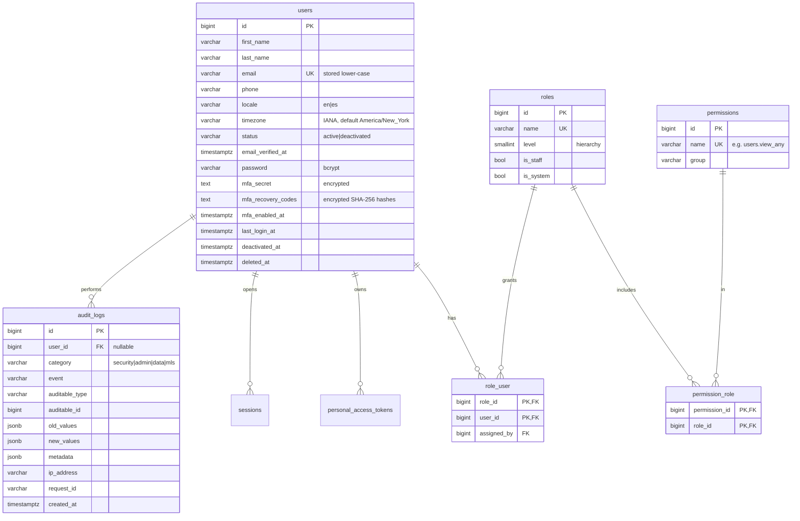
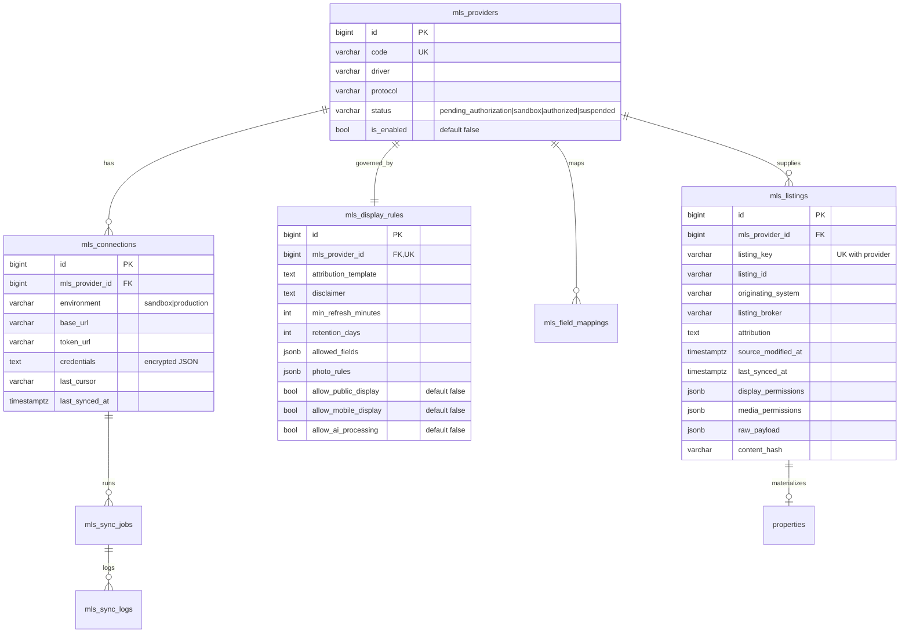

# Database Model (PostgreSQL 16 + PostGIS 3)

Conventions: `bigint` identity PKs, `timestamptz` everywhere (UTC), `jsonb` for flexible
attributes, soft deletes (`deleted_at`) on business entities, FK constraints with explicit
`ON DELETE` behaviour, and every migration reversible except the PostGIS extension (dropping
it must be a deliberate DBA action).

Legend: ✅ migrated today · 🗓️ designed, migration arrives with its sprint.

## 1. Identity, RBAC and audit ✅

Also present: `password_reset_tokens`, `sessions` (database session driver), `personal_access_tokens`
(Sanctum), `cache`, `jobs`, `failed_jobs`, `job_batches`.

## 2. MLS integration ✅

✅ `mls_listings` uses the composite unique key **(mls_provider_id, listing_key)** so identical
`ListingKey`/`ListingId` values from different MLSs never collide; `removed_at` marks listings the
provider no longer returns (they are hidden at once, never hard-deleted by a sync).
✅ `mls_field_mappings` (provider-specific overrides of the RESO mapping), `mls_sync_jobs` (type
import|incremental|reconcile, status, stats jsonb, cursor before/after, error) and `mls_sync_logs`
(per-record outcome, `listing_key` ≤ 100 chars). 🗓️ `mls_licenses` (licence documents, scope,
expiry) is deferred until the first agreement exists.

## 3. Listings ✅ · geography and search 🗓️

* ✅ `properties`: internal or MLS-sourced (`source`, `mls_listing_id` FK nullable), `property_type_id`,
  `listing_status`, `list_price numeric(14,2)`, `currency char(3) default 'USD'`, address columns,
  `location geography(Point,4326)` with **GiST index**, bedrooms, bathrooms `numeric(4,1)`,
  `living_area_sqft`, `lot_size_sqft`, `year_built`, parking/garage, `hoa_fee_monthly`,
  `annual_taxes`, `features jsonb`, `listing_agent_id`, `slug` (unique), `published_at`, soft deletes.
  B-tree indexes on `(listing_status, list_price)`, `(city_id)`, `(postal_code)`; partial index on
  public/active listings.
* ✅ `property_types` (RESO PropertyType mapping), amenities as a validated `jsonb` list on
  `properties`, `property_media` (disk + path or MLS URL, order, dimensions, `display_allowed`),
  `property_status_history` (append-only status/price changes with source). 🗓️ `open_houses`.
* `states`, `counties`, `cities`, `postal_codes`, `locations` (autocomplete; optional boundary
  `geography(MultiPolygon)` for polygon search).
* `favorites`, `saved_searches` (filters jsonb + optional polygon), `property_views`.

## 4. Agency ✅ · CRM and scheduling 🗓️

* ✅ `agencies` (slug, brokerage licence as entered, timezone, settings jsonb, soft deletes).
* ✅ `offices` (agency FK, address, `latitude`/`longitude` + **generated** `location geography(Point,4326)`
  with GiST index, partial unique index: one headquarters per agency, soft deletes).
* ✅ `agents` (user_id unique FK, agency FK, office FK nullOnDelete, slug unique, public contact,
  bio/bio_es, languages/specialties jsonb, status, `is_public`, soft deletes).
* ✅ `agent_licenses` (number, state, type, status `pending_verification|verified|rejected|expired|revoked`,
  issued/expires dates, `submitted_by`, `verified_by`, `verified_at`, `verification_source`,
  `verification_reference`, notes, `status_changed_by/at`, `status_reason`; partial unique index on
  `(license_state, upper(license_number))` for pending/verified). A typed licence number is never
  treated as verified.
* ✅ `notifications` (Laravel database notifications, jsonb data).
* `lead_sources`, `leads` (assigned agent, status, budget range, preferences jsonb, dedup keys on
  normalized email/phone), `lead_assignments`, `lead_activities` (call/email/note/task),
  `crm_pipelines`, `crm_stages`, `tasks`.
* `appointments` (`starts_at`/`ends_at` timestamptz + `timezone`, status, **exclusion constraint**
  `EXCLUDE USING gist (agent_id WITH =, tstzrange(starts_at, ends_at) WITH &&) WHERE status in
  (requested, confirmed)` to prevent double-booking), `agent_availability`.

## 5. Transactions, documents, messaging, notifications 🗓️

* `offers`, `transactions`, `transaction_milestones`, `transaction_documents`; monetary values
  `numeric(14,2)`; state machine enforced in the application layer and audited.
* `documents` (private R2 key, mime, size, sha256, classification, retention_until),
  `document_versions`, `document_access_logs`.
* `conversations`, `conversation_participants`, `messages` (read receipts per participant).
* `notifications` (Laravel), `notification_preferences` (channel × event, consent timestamps).
* `system_settings` (key/value jsonb, audited).

## 6. Idempotency 🗓️

`idempotency_keys` (`key`, `user_id`, `request_hash`, `response jsonb`, `expires_at`) backs the
`Idempotency-Key` header on critical POSTs (offers, appointments, transactions).
